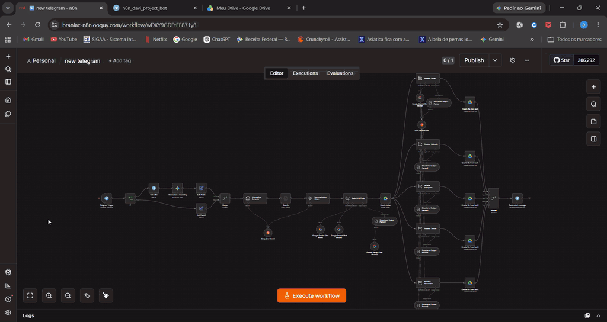
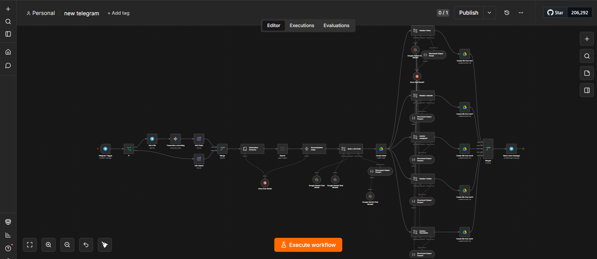
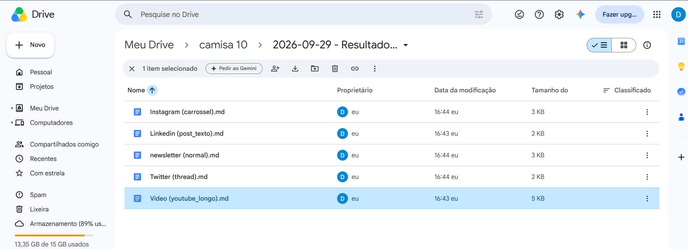
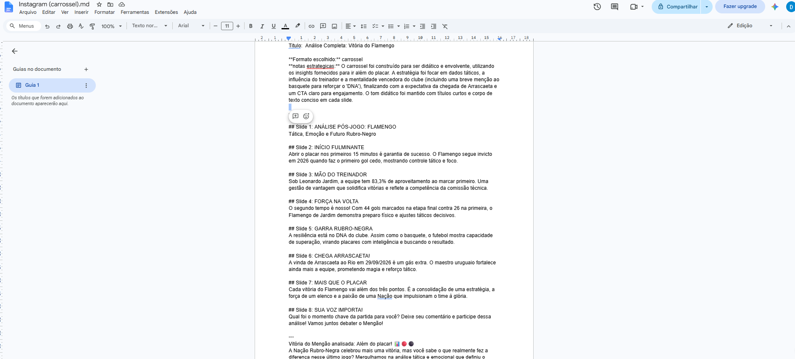
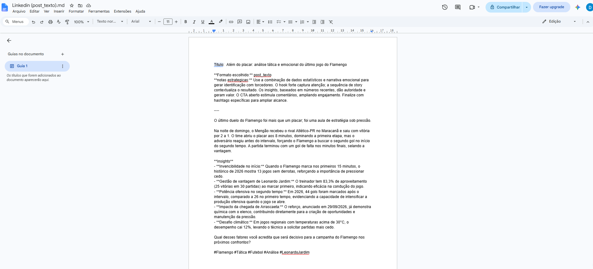
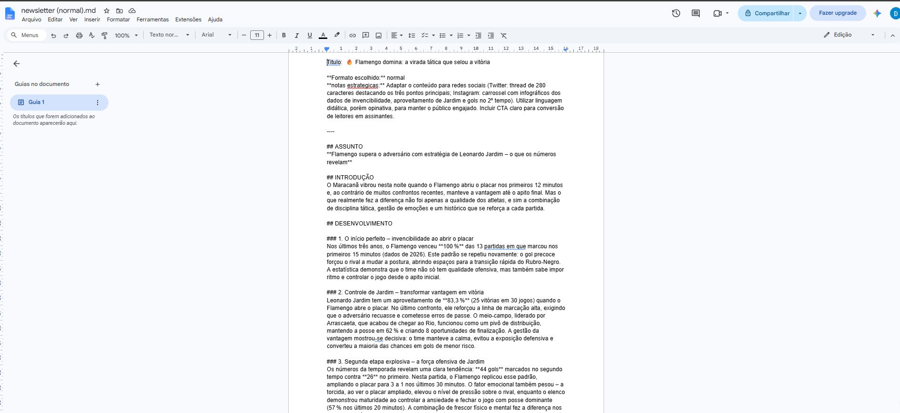
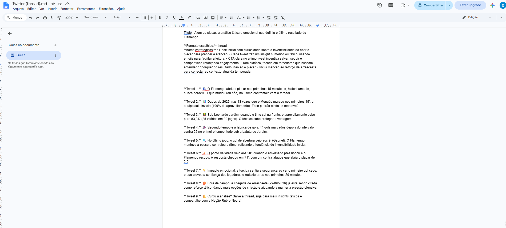
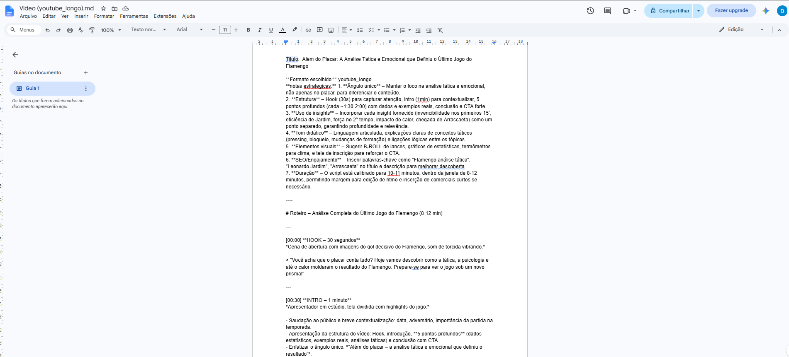
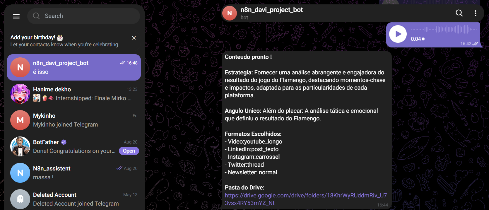

# ContentResearch-AI

**Pesquisa automatizada na web e geração de conteúdo multicanal com n8n e Inteligência Artificial.**

O ContentResearch-AI transforma mensagens enviadas pelo Telegram em conteúdos personalizados para Instagram, LinkedIn, Newsletter e YouTube. A solução utiliza pesquisa na web com Tavily, IA generativa e integração com Google Drive para automatizar o processo de pesquisa, produção e organização de conteúdo.

## Demonstração



## Sobre o projeto

Pesquisar um assunto, identificar informações relevantes e adaptar o conteúdo para diferentes plataformas exige tempo e trabalho manual.

O ContentResearch-AI foi desenvolvido para automatizar esse processo por meio de um workflow no n8n.

O usuário envia uma mensagem de texto ou áudio pelo Telegram. Quando a entrada é um áudio, o workflow executa a etapa de processamento de áudio configurada. Em seguida, o sistema pesquisa o assunto com Tavily, utiliza IA generativa para produzir quatro formatos de conteúdo, cria uma pasta no Google Drive e envia o link dos resultados pelo Telegram.

## Funcionalidades

- Recebimento de mensagens por Telegram.
- Processamento de entradas de texto e áudio.
- Pesquisa de informações na web com Tavily.
- Síntese de informações para geração de conteúdo.
- Geração de conteúdo para Instagram.
- Geração de conteúdo para LinkedIn.
- Produção de newsletters.
- Criação de roteiros para YouTube.
- Criação automática de pasta no Google Drive.
- Armazenamento dos quatro conteúdos gerados.
- Envio do link da pasta ao usuário pelo Telegram.

## Arquitetura



Fluxo lógico da solução:

```text
Telegram
   |
   v
Processamento da mensagem
   |
   v
Pesquisa na web - Tavily
   |
   v
Síntese das informações
   |
   +------> Conteúdo Instagram
   |
   +------> Conteúdo LinkedIn
   |
   +------> Newsletter
   |
   +------> Roteiro YouTube
   |
   v
Criação de pasta no Google Drive
   |
   v
Armazenamento dos arquivos
   |
   v
Envio do link pelo Telegram
```

## Tecnologias utilizadas

- **n8n:** orquestração do workflow e integração dos serviços.
- **Telegram Bot API:** recebimento de mensagens e entrega dos resultados.
- **Tavily:** pesquisa na web.
- **IA generativa / LLMs:** síntese e geração de conteúdo.
- **Google Drive:** criação de pastas e armazenamento dos arquivos.
- **APIs:** comunicação entre os serviços integrados.

Os provedores e modelos específicos de IA devem ser consultados na configuração dos nodes do workflow.

## Resultados gerados

Cada solicitação processada pode produzir quatro conteúdos:

| Arquivo    | Finalidade                    |
| ---------- | ----------------------------- |
| Instagram  | Publicação para redes sociais |
| LinkedIn   | Conteúdo profissional         |
| Newsletter | Texto informativo para e-mail |
| YouTube    | Roteiro para vídeo            |

Os quatro resultados são armazenados na pasta criada pelo sistema.



## Instagram



## LinkedIn



## Newsletter



## Twitter



## Youtube



## Entrega pelo Telegram

Após a criação dos arquivos, o usuário recebe uma mensagem contendo o link da pasta no Google Drive.



## Estrutura do repositório

```text
ContentResearch-AI/
├── docs/
│   ├── arquitetura.md
│   ├── fluxo.md
│   ├── regras-negocio.md
│   ├── processamento-audio.md
│   └── formatos-conteudo.md
├── images/
├── gifs/
├── workflows/
│   └── content-research-ai.json
├── prompts/
│   ├── instagram.txt
│   ├── linkedin.txt
│   ├── newsletter.txt
│   └── youtube.txt
├── .gitignore
├── LICENSE
└── README.md
```

## Documentação

- [Arquitetura](docs/arquitetura.md)
- [Fluxo de execução](docs/fluxo.md)
- [Regras de negócio](docs/regras-negocio.md)
- [Processamento de áudio](docs/processamento-audio.md)
- [Formatos de conteúdo](docs/formatos-conteudo.md)

## Como configurar

### Pré-requisitos

- Instância do n8n.
- Bot do Telegram configurado.
- Credenciais de acesso ao Tavily.
- Credenciais do provedor de IA utilizado.
- Credenciais de acesso ao Google Drive.

### 1. Obtenha o workflow

Clone este repositório:

```bash
git clone https://github.com/SEU-USUARIO/ContentResearch-AI.git
cd ContentResearch-AI
```

### 2. Importe o workflow

No n8n, utilize a opção de importar workflow a partir de arquivo e selecione:

`workflows/content-research-ai.json`

### 3. Configure as credenciais

Configure no n8n as credenciais necessárias para Telegram, Tavily, o provedor de IA e Google Drive.

Associe cada credencial aos respectivos nodes.

### 4. Revise a configuração

Confira os parâmetros, os identificadores necessários, as permissões do Google Drive e o comportamento dos nodes de processamento de áudio.

### 5. Teste a execução

Envie uma mensagem de texto pelo Telegram e confirme que os quatro arquivos foram criados e que o link foi entregue.

Depois, teste uma mensagem de áudio separadamente.

> A importação do workflow não configura automaticamente as credenciais ou permissões da sua conta. Podem ser necessários ajustes conforme o ambiente.

## Segurança

- Não publique tokens do Telegram.
- Não publique chaves do Tavily ou do provedor de IA.
- Não publique credenciais OAuth ou arquivos de autenticação.
- Revise o JSON exportado antes de colocá-lo no GitHub.
- Utilize dados de demonstração e links de teste.
- Confira as permissões de compartilhamento das pastas no Google Drive.

## Limitações

- A qualidade do conteúdo depende das informações recuperadas e do modelo utilizado.
- Os resultados gerados por IA precisam de revisão antes da publicação.
- A disponibilidade depende dos serviços e das credenciais configuradas.
- A transcrição e a tradução são operações diferentes; o comportamento de áudio depende da implementação efetiva do workflow.

## Aprendizados técnicos

Este projeto explora:

- automação de processos com n8n;
- integração entre APIs;
- pesquisa na web;
- engenharia de prompts;
- aplicações com LLMs;
- geração de conteúdo especializado;
- processamento de entradas por texto e áudio;
- armazenamento automatizado em nuvem;
- integração com bots do Telegram.

## Autor

**Davi Santos**

Ciência da Computação | Python | IA Generativa | Automação | Dados | n8n
